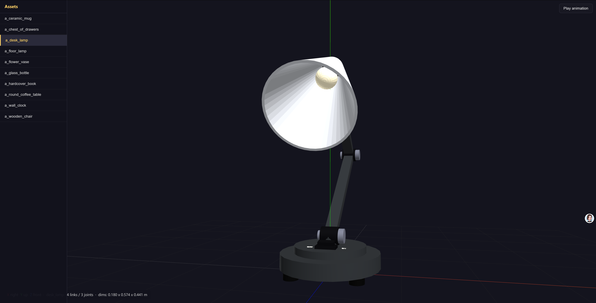

# ArtiAgent

ArtiAgent 是 SEAL 流水线里的"单物体铰接资产生成器"。给定一个物体描述（可选参考图、可选布局 box），它驱动一个 LLM 反复编辑 `model.py`（用 SDK 编写铰接物体），编译、质检，最终产出可用的 URDF + mesh 资产，并把结果记录到 `data/records/`。

- 坐标系约定：**y-up / +z-forward**（+X 右、+Y 上、+Z 前/朝相机）。
- 物体按"几何中心在原点 (0,0,0)"建模，放置变换（center + rpy）单独由下游应用。
- 默认 provider：deepseek（模型 deepseek-flash）。

---

## 一、main.py 参数说明

用法：`python main.py --task <text> [options]`

| 参数 | 说明 |
|---|---|
| `--task <text>` | **必填**。用户请求，描述要生成的物体。 |
| `--provider <name>` | LLM 提供方：`deepseek` \| `qwen`。默认取 `$PROVIDER` 或 `deepseek`。 |
| `--model <id>` | 覆盖模型 id（优先级最高：`--model` > `{NAME}_MODEL` > `MODEL` > 默认）。 |
| `--image <path>` | 可选的参考图片（需 provider 支持 vision）。有图时 structurer 会看图扩展 prompt。 |
| `--emit-result <path>` | 把结果 JSON 写到指定路径。当前结构为 `{"asset_dir", "center", "dims", "rpy"}`：`asset_dir` 指向 record 目录，`center`/`rpy` 是放置变换（来自 `--box`，无 box 时为 `[0,0,0]`），`dims` 是实测自然尺寸。 |
| `--box <cx,cy,cz>,<w,h,l>[,<rx,ry,rz>]` | 布局给的参考 box（**软约束**，不再强制缩放）。`center`/`dims`/`rpy`，其中 **rpy 单位是弧度**。物体按自然尺寸建模，编译时 harness 会报告与参考 box 的差值，由 LLM 判断尺寸是否可接受。 |
| `--structure <mode>` | 何时把 prompt 展开成 design brief：`always` \| `auto` \| `never`。默认 `auto`（≤8 词的 prompt 才展开）。 |
| `--max-rounds <n>` | 最大 agent 轮数，默认 100。传 `unlimited`（或 `0`）表示不限制。 |
| `--edit <record_id>` | 基于已有 record 进行编辑（fork 其 model.py 作为起点）。 |
| `--reason <mode>` | 配合 `--edit`：`creation`（默认）或 `fix_bugs`（把这次编辑蒸馏成可复用 skill）。 |
| `-c <session_id>` | 恢复之前的 session。 |
| `-restore <path>` | 从 `.trash/` 恢复一个备份的 model.py。 |
| `--review` | 运行结束后对该 session 跑自改进 reviewer。 |

### 环境变量

| 变量 | 说明 |
|---|---|
| `PROVIDER` | 默认 provider（`deepseek`）。 |
| `OPENAI_API_KEY` | DeepSeek 的 API key。 |
| `DASHSCOPE_API_KEY` | Qwen 的 API key。 |
| `DEEPSEEK_MODEL` / `QWEN_MODEL` | 各 provider 的模型覆盖。 |
| `MODEL` | 通用模型覆盖（仅 DeepSeek）。 |
| `DEEPSEEK_BASE_URL` / `QWEN_BASE_URL` | 各 provider 的 endpoint 覆盖。 |
| `OPENAI_BASE_URL` | DeepSeek endpoint 覆盖（向后兼容）。 |

---

## 二、目录 / 文件说明

### 根目录

| 路径 | 说明 |
|---|---|
| `main.py` | 入口：解析参数、装配 agent、跑 LLM 循环、落 record。 |
| `model.py` | **工作文件**，LLM 反复编辑的就是它。约定定义 `build_object_model()` 并赋给模块级 `object_model`。 |
| `scaffold.py` | `model.py` 的初始模板（`ensure_model_scaffold` 用它重置）。 |
| `basic_tools.py` | 基础工具：`read_file` / `write_file` / `edit_file` / `list_files` / `bash`，以及共享常量与辅助函数（`WORK_DIR`、`TRASH_DIR`、`MODEL_FILENAME`、`tail`、`backup_if_exists`、`restore` 等）。 |
| `tools/` | 领域工具，每个工具一个文件：`compile.py`（`CompileModelTool`，含 `--box` 差值反馈）、`probe.py`（`ProbeModelTool`）、`real_bbox.py`（`RealBboxTool`）、`find_examples.py`（`FindExamplesTool`）。 |
| `provider.py` | LLM provider 配置（deepseek / qwen 的默认模型、base_url、api_key_env）。 |
| `materialize_cli.py` | 把某个 record 的 model.py 重新编译物化成 `model.urdf` + meshes，可导出到指定目录。 |
| `viewer.py` | 本地 asset viewer（从 BaseAgent 的 room_viewer 复制改造）：加载 `assets/10_assets_only_text/*.json`，左侧竖直列表点击渲染单个物体，带 XOZ 网格 + 坐标轴。 |
| `budget.py` / `compression.py` / `memory.py` / `session_layer.py` / `subagent_layer.py` / `skill_layer.py` / `registry_layer.py` | 框架支撑：预算、上下文压缩、记忆、session、subagent、skill、工具注册。 |
| `smoke_compile.py` | 编译冒烟测试。 |
| `README.md` | 本文件。 |

### `agent/`

| 路径 | 说明 |
|---|---|
| `compiler.py` | 编译核心：`compile_urdf_report_maybe_timeout`（执行 model.py → 建 object_model → 导出 URDF XML，带超时保护）。 |
| `bbox.py` | `compute_model_real_bbox`（joint-range 真实包围盒）。 |
| `persistence.py` | record 的写入/物化（`write_success_record`、`materialize_record`）。 |
| `structurer.py` | 把 terse prompt 展开成 design brief。 |
| `feedback.py` | 编译结果格式化（`render_compile_signals`）。 |
| `prompts/` | prompt 文件（`designer_system_prompt_*.txt` 等，含坐标系约定）。 |

### `sdk/`

model.py 作者使用的公开 SDK。

| 路径 | 说明 |
|---|---|
| `sdk/v0/` | 公开 API 入口（`ArticulatedObject`、`mesh_from_cadquery`、`fit_to_box` 等 re-export）。 |
| `sdk/_core/v0/` | 核心实现（articulated object、URDF export、fit_to_box、real_bounding_box、mesh 等）。 |
| `sdk/_extensions/` | 扩展，主要是 CadQuery。 |
| `sdk/_extensions/cadquery/v0/cadquery.py` | **CadQuery 扩展，OBJ 保存功能就在这里**：`mesh_from_cadquery` → `export_cadquery_mesh` → `_tessellate_cadquery_shape`（三角化 + **z-up→y-up 转换**）→ `_write_obj`（把顶点/面写成 `.obj`）。 |
| `sdk/_core/v0/fit_to_box.py` | `fit_to_box`（现为 **no-op**，旧的等比缩放逻辑已废弃，改为编译期 box 差值反馈）。 |
| `sdk/_core/v0/real_bounding_box.py` | `joint_range_bounding_box`（关节全运动范围的 swept AABB）。 |
| `sdk/_docs/` / `sdk/_examples/` | SDK 文档 / 示例（LLM 会 read_file 参考）。 |

### `storage/`

| 路径 | 说明 |
|---|---|
| `layout.py` | 存储布局（records / cache / revisions 等路径）。 |
| `records.py` / `revisions.py` | record 与 revision 的读写。 |
| `materialize.py` | 物化路径/摘要。 |

### 其它目录

| 路径 | 说明 |
|---|---|
| `data/` | 运行时数据（gitignore）：`data/records/`（record）、`data/cache/record_materialization/`（物化的 model.urdf + meshes）。 |
| `assets/` | 生成的资产导出（如 `assets/10_assets_only_text/`）。 |
| `input/` | 输入参考图片。 |
| `test/` | 测试脚本（如 `10_assets_only_text.sh` 批量生成、`postprocess_10.py` 后处理）。 |
| `articraft/` | Articraft 相关（`values.py`，record 来源/值）。 |

---

## 三、viewer 使用示例

ArtiAgent 自带一个本地资产查看器 `viewer.py`（从 BaseAgent 的 room_viewer 复制改造，只加载 `assets/10_assets_only_text/*.json`）。

### 启动

```bash
cd /mnt/sda/johnli/SEAL/ArtiAgent
python3 viewer.py --port 8766
```

（`--port` 可换成任意空闲端口，默认 8000。）

### 打开

浏览器访问 `http://<服务器IP>:8766/`（本机就是 `http://localhost:8766/`）。

### 怎么看 / 怎么操作

- **左侧竖直列表**：列出所有资产，**点击某个物体**就在右侧单独渲染它。
- **旋转 / 缩放 / 平移**：鼠标左键拖拽旋转，滚轮缩放，右键拖拽平移（OrbitControls）。
- **坐标系参照**：XOZ 水平网格平面 + 三色坐标轴，**X 红 = 右、Y 绿 = 上、Z 蓝 = 前**；轴和网格会随当前物体尺寸自适应。
- **关节动画**：右上角 "Animate joints" 按钮切换铰接关节的动画（抽屉、灯臂、时钟指针等）。
- 左下角图例显示当前物体的名字、links/joints 数量、实测尺寸（dims）。

### 截图示例



