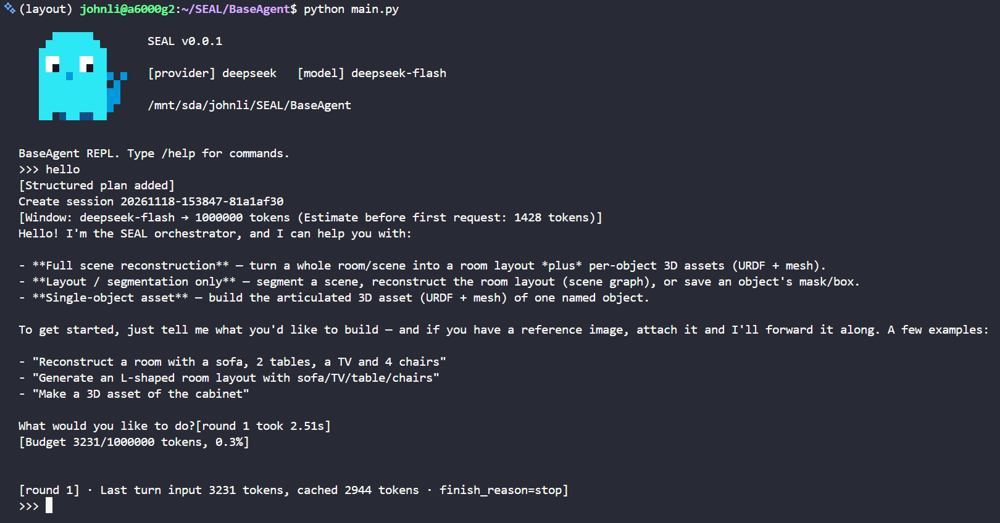

# SEAL: Scene Engine for Articulated Layout

**SEAL** 是一个分层的多 agent 系统：从单张室内图片（或纯文本描述）重建场景，产出房间布局（scene graph）+ 每个物体的铰接 3D 资产（URDF + mesh）。

## Bug List

1. Layout朝向 用PCA估计太不准了
2. memory应该添加里程碑，避免重复调用工具
3. image指导的场景重建太不准了：遮挡物体幻觉，朝向，大小等很难调

## Agents 总览

SEAL 由三个相互独立的 agent 组成，各自有独立的 system prompt / SDK / session / 文件树，通过 subprocess 以 JSON 契约（JSON in / JSON out）串联：

| Agent | 作用 | 感知 / 几何 |
|-------|------|-------------|
| **BaseAgent** | 常驻编排器（REPL）。决定把任务委派给哪个子 agent，并把子 agent 的日志流回终端。 | DeepSeek（支持 vision） |
| **LayoutAgent** | 整图分割 + 房间重建 → `room.py` 场景图（nodes/edges）。 | SAM3（分割）、DA3（度量深度） |
| **ArtiAgent** | 单物体铰接资产生成（URDF + mesh）。 | cadquery / manifold3d / python-fcl / trimesh |

```
┌──────────────────────────────────────────────────────────┐
│                       BaseAgent (REPL)                    │
│   读/写/编辑工具 · 委派规则 · session                       │
└──────────────┬───────────────────────────┬───────────────┘
               │ call_layout_agent          │ call_arti_agent / reconstruct_scene
               ▼ (subprocess, JSON)         ▼ (subprocess, JSON)
┌──────────────────────────┐   ┌────────────────────────────┐
│       LayoutAgent        │   │         ArtiAgent          │
│  SAM3 分割 → DA3 深度     │   │  物体描述/mask → 铰接资产  │
│  → room.py 场景图         │   │  (URDF + mesh)             │
└──────────────────────────┘   └────────────────────────────┘
```

## 各 agent 目录简介与详细文档

### 1. BaseAgent —— 编排器（orchestrator）

- `main.py`：入口，支持 one-shot 和交互式 REPL 两种模式。
- `subprocess_agent.py`：子进程委派层，把任务委派给 LayoutAgent / ArtiAgent，并实现 `reconstruct_scene` 端到端管线（layout → 按 class 去重 → 并行 ArtiAgent → 实例化）。
- `agent/prompts/`：路由规则（`tools_instruction.md` / `system.md`）。
- `agent/structurer.py`：把用户 prompt 结构化出执行计划（路由到正确工具）。
- `tools/call_subagent.py`：委派工具（`call_layout_agent` / `call_arti_agent` / `reconstruct_scene`）。
- `room_viewer.py`：完整场景 viewer（layout + 多个资产）。
- `output/`：委派结果（`layoutagent/` 场景图、`artiagent/` 资产结果 JSON）。

> 详细文档：BaseAgent 暂无独立 README，见 [`BaseAgent/EXECUTION_PLAN.md`](BaseAgent/EXECUTION_PLAN.md)（执行计划）与 [`BaseAgent/hierarchy_plan.md`](BaseAgent/hierarchy_plan.md)（层级设计）。

### 2. LayoutAgent —— 布局重建（layout reconstruction）

- `main.py`：入口，感知 + write-compile 循环。
- `schema.py`：场景图数据契约（node/edge 类型，坐标系约定）。
- `tools/`：感知与反馈工具 —— `segmentation.py`（SAM3）、`reconstruction.py`（DA3）、`compile.py`（跑 room.py → 校验 → 诊断）。
- `sdk/`：几何 / 校验 / 投影 / 拟合 / Manhattan / 朝向分析。
- `agent/prompts/`：prompt（`docs.md` SDK 参考、`system_prompt.md` 系统提示）。

> 详细文档：见 [`LayoutAgent/README.md`](LayoutAgent/README.md)。

### 3. ArtiAgent —— 单物体铰接资产（articulated asset generation）

- `main.py`：入口，驱动 LLM 反复编辑 `model.py`（write-compile-fix 循环）。
- `model.py`：LLM 编辑的工作文件，定义 `build_object_model()`。
- `basic_tools.py` + `tools/`：LLM 工具（read/write/edit/bash/list + compile/probe/real_bbox/find_examples）。
- `sdk/`：模型作者使用的 SDK；重点 `sdk/_extensions/cadquery/v0/cadquery.py`（CadQuery 扩展，OBJ 保存 + z-up→y-up 转换）。
- `storage/` / `data/`：record 存储与物化（`data/records/`、`data/cache/record_materialization/`）。
- `viewer.py`：本地资产 viewer（竖直列表点击渲染单个物体）。

> 详细文档：见 [`ArtiAgent/README.md`](ArtiAgent/README.md)（含 main.py 参数说明、目录说明、viewer 使用示例）。

## Quick start

```bash
cd SEAL/BaseAgent
# one-shot（带图）：
python main.py --image input/kitchen.png --task "reconstruct the kitchen"
# 交互式 REPL：
python main.py
```

REPL 内 `/image <path>` 给下一轮附加图片，`/help` 列出命令。委派规则在 `BaseAgent/agent/prompts/tools_instruction.md`。

## Requirements

- Linux 服务器 + CUDA GPU（SAM3 / DA3 推理走 bf16）。
- Conda 环境 `layout`（Python 3.10），包含两个子 agent 的依赖：LayoutAgent（SAM3 / depth-anything-3）、ArtiAgent（cadquery 2.7、manifold3d、python-fcl、trimesh、networkx、zstandard、numpy 2.2.6）。
- 大模型权重放在 `$HOME` 下，不入库：SAM3 checkpoint、DA3 权重。

可覆盖的路径 / 环境变量：

| Env var | 默认值 | 用途 |
|---------|--------|------|
| `LAYOUT_PYTHON` / `ARTI_PYTHON` | `<conda>/envs/layout/bin/python` | BaseAgent 委派给两个子 agent |
| `LAYOUT_AGENT_DIR` / `ARTI_AGENT_DIR` | `<SEAL>/LayoutAgent` / `<SEAL>/ArtiAgent` | 子 agent 目录 |
| `SAM3_CHECKPOINT` / `DA3_MODEL` | modelscope 缓存 / `~/models/DA3NESTED-GIANT-LARGE` | 模型权重 |

---

## 示例：BaseAgent 入口（REPL）

启动 BaseAgent 交互式 REPL：

```bash
cd SEAL/BaseAgent
python main.py
```

进入后是一个长驻会话，可多轮连续输入。常用命令：

- `/help` —— 查看命令列表
- `/image <path> [task]` —— 给下一轮附加一张图片（可带任务）
- `/new` —— 开一个新会话
- `/history` —— 查看输入历史
- `/exit` / `/quit` —— 退出

输入任务后，BaseAgent 的 structurer 会先把任务结构化出执行计划，再按路由规则委派给 `reconstruct_scene`（整场景）、`call_layout_agent`（只布局）或 `call_arti_agent`（单物体）。

### 截图示例



